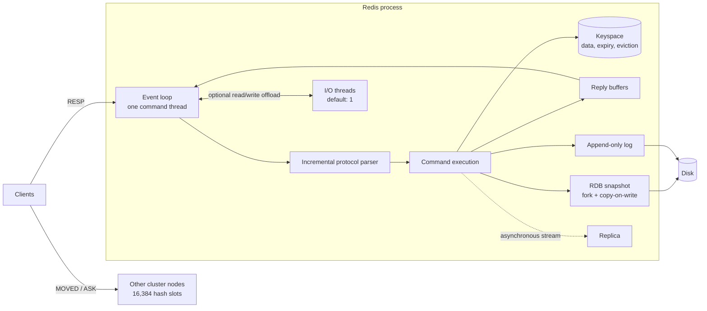
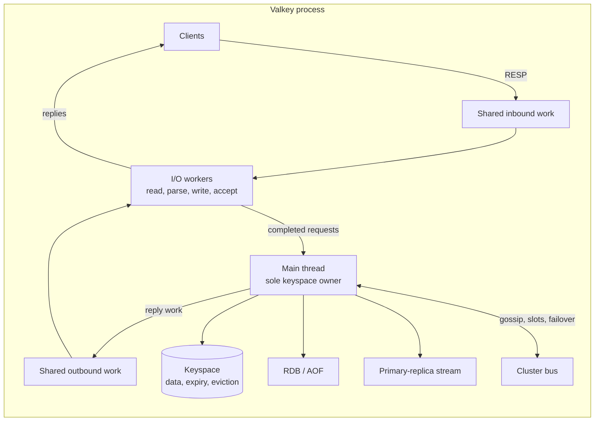
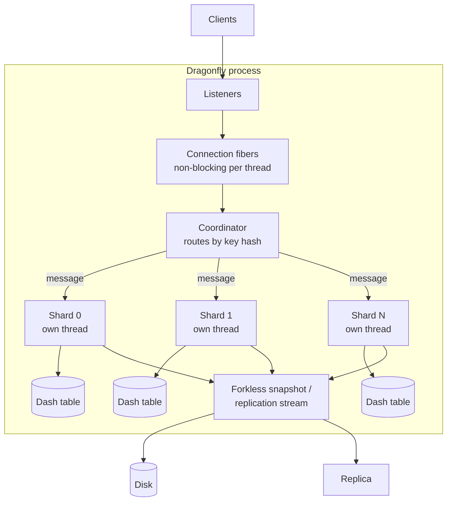
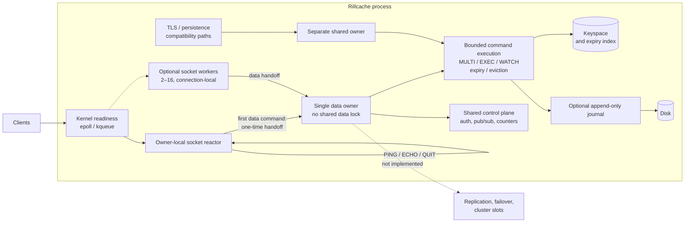

# Architecture approaches: Redis, Valkey, Dragonfly and Rillcache

Status: research and design note, 4 November 2026. This document compares
architectural approaches, not feature checklists, benchmark victories or
production-readiness claims. The reference releases used for source reading and
the repository's pinned comparisons are Redis 8.10.2, Valkey 9.1.2 and Dragonfly
2.0.2. Those pins are reproducible snapshots, not an evergreen "latest" claim.

The question is deliberately narrow: **where does command execution happen, how
does I/O reach it, where does data live, and what does each choice cost?** The
diagrams are conceptual. They avoid internal type, module and function names so
that the comparison survives refactoring. "Owner" below means the thread that is
allowed to mutate a keyspace; it is not a product name.

## At a glance

| Property | Redis | Valkey | Dragonfly | Rillcache |
| --- | --- | --- | --- | --- |
| Command execution | One ordered command thread | One ordered main thread | Many shard-owning threads | One data owner by default |
| Network parallelism | Optional I/O threads | Concurrent I/O worker pool | Fiber-based per-thread event loops | Kernel readiness; optional connection-local socket workers |
| Data placement | One keyspace per node | One keyspace per node | Shared-nothing shards in one process | One keyspace default; opt-in owners |
| Scale-out model | Cluster hash slots | Cluster hash slots | Vertical shards, then cluster data plane | Standalone only |
| Persistence | RDB snapshots and AOF | RDB snapshots and AOF | Forkless snapshots and AOF/replication | Optional best-effort AOF |
| Replication | Asynchronous primary-replica | Asynchronous primary-replica | Asynchronous, per-shard backlog | Not implemented |
| Safety boundary | C | C | C++ with custom low-level machinery | Unsafe-free application Rust with reviewed dependencies |

Two distinctions matter throughout:

1. **I/O parallelism is not command parallelism.** Redis and Valkey can read,
   parse and write on several threads while one thread still orders every data
   mutation. Dragonfly and Rillcache's optional multi-owner mode execute commands
   on more than one owner.
2. **A cluster is not a bigger event loop.** Redis, Valkey and Dragonfly clusters
   partition keys across processes and add redirection, replication and failure
   handling. Rillcache deliberately does not pretend to have that topology.

## Redis: one ordered command lane

### Shape

### How a request moves

One event loop waits for socket readiness, accepts connections, reads complete
requests, executes commands in arrival order, builds replies, and writes them
back. The loop is the ordering point: a command sees a consistent keyspace
because no other command executes at the same time. Optional I/O threads can take
socket reads, writes and parsing work, but they hand complete work back to the
command thread; they do not mutate the keyspace.

Redis also separates work that should not block the loop: background saving,
AOF fsync/rewrite, lazy freeing and replication all have their own mechanisms.
A cluster adds a second layer: keys map to 16,384 slots, clients cache the slot
map, and a node that does not own a slot returns `MOVED` or `ASK` instead of
proxying the request. Replication is asynchronous, with `WAIT` available for a
bounded acknowledgement request but not for strong consistency.

### Strengths

- **Simple correctness model.** One command at a time removes data-structure
  races and makes multi-key and transaction ordering easy to reason about.
- **Predictable per-command latency.** There are no cross-thread data hops or
  shard reservations on the ordinary path.
- **Mature operational model.** Persistence, replication, Sentinel, Cluster and
  client libraries are widely deployed and documented.
- **I/O threads are an optional escape hatch.** Network-heavy workloads can use
  more cores without changing the execution model.
- **Rich incremental data structures.** Compact encodings and incremental
  rehashing keep large keyspaces practical.

### Costs

- **One command thread is a single-node CPU ceiling.** I/O threads move bytes,
  not command execution, so a CPU-bound workload cannot use every core in one
  process.
- **Fork-based persistence has a memory and latency tail.** Copy-on-write can
  spike memory and pause the parent during large saves; AOF rewrite has similar
  operational cost.
- **Cluster is a client-redirection model.** Multi-key commands are limited to
  one slot unless hash tags are used, and resharding is operationally involved.
- **Asynchronous replication has a loss window.** Acknowledged writes can be lost
  during failover; `WAIT` narrows but does not remove the window.
- **The event loop is a serialization point under overload.** Long commands,
  huge replies and slow clients require careful bounds.

**Best fit:** a general-purpose cache/database where predictable semantics,
ecosystem maturity and a simple single-node model matter more than using every
core in one process.

## Valkey: the same execution model with a more parallel transport

### Shape

### How a request moves

Valkey keeps Redis's central rule: the main thread owns all data mutation and
orders command execution. What changes is the transport around it. A pool of I/O
workers performs predefined jobs such as socket reads, writes, accepts, polling
and deferred frees. Workers publish results back to the main thread; the main
thread applies state changes. The queues and job lifecycle are deliberately
bounded, with backpressure and drain barriers for reconfiguration and shutdown.

Valkey 8.0 made the main thread and I/O workers operate concurrently and added
command batching and more offload. Later releases added server-side atomic slot
migration and multi-database cluster support. Full synchronization uses a
dual-channel design: the snapshot travels on one channel while the replica
accumulates the concurrent change stream on another, reducing the primary's
buffer pressure.

### Strengths

- **Higher network throughput without changing the data model.** Read, parse and
  write work can use multiple cores while command ordering stays simple.
- **Compatible semantics.** Existing Redis clients and operational knowledge
  mostly carry over.
- **Better replication and cluster behavior.** Dual-channel full sync reduces
  primary memory pressure; atomic slot migration and replicated slot state make
  resharding more reliable.
- **Bounded job system.** The worker pool has explicit eligibility checks,
  backpressure, drain points and joined shutdown rather than unbounded fan-out.
- **Open governance and a permissive license.** This matters to many operators
  even though it is not an execution-model property.

### Costs

- **The main thread still serializes data mutation.** I/O threads help network
  and parsing cost, but a CPU-bound command mix still hits the same ceiling.
- **More concurrency means more coordination.** Queue contention, worker
  wakeups, completion ordering and drain logic are real complexity and can
  regress tail latency if tuned badly.
- **Gains are workload-dependent.** Read/write-heavy, high-connection workloads
  benefit more than small pipeline-1 command streams.
- **Cluster limits remain.** Multi-key operations still need co-location, and
  asynchronous replication still has a failover loss window.
- **It is an evolution of Redis's model, not a replacement for it.** The
  architectural delta is mostly transport, replication and cluster reliability.

**Best fit:** deployments that want Redis compatibility and better multi-core
network utilization, but do not want to adopt a sharded execution model.

## Dragonfly: many owners inside one process

### Shape

### How a request moves

Dragonfly runs one process with several threads. Each thread can own connections
and a database shard; fibers make blocking-looking work asynchronous without
blocking the thread. A connection fiber acts as a coordinator: it hashes the key,
sends a message to the owning shard, and waits for the result. Shard data is not
protected by a global mutex because it is only accessed by its owning thread.
Multi-key commands and transactions are coordinated across owners with
reservations and message passing.

The storage layout is a directory of fixed-size segments, each a small
open-addressed table. A full segment splits into two; the table grows in small
steps instead of allocating a large second table. This reduces per-entry metadata
and avoids the large allocation spike of a classic chained dictionary. Snapshots
are forkless: each shard serializes its own data under a captured cut, and a
background fiber assembles the output.

Dragonfly supports replication with per-shard backlogs and a multi-shard cluster
data plane, but the server does not provide the full cluster control plane;
deployment, health management, failover and rebalancing are external (for
example, a managed service or operator).

### Strengths

- **Vertical scaling in one process.** More cores can execute data commands on
  separate shards without a cluster of separate servers.
- **No global data lock.** Shard-local ownership removes lock contention on the
  ordinary path.
- **Memory-efficient table design.** Segment-based open addressing reduces
  metadata and avoids a large rehash allocation spike.
- **Forkless snapshots.** No copy-on-write fork; shards serialize concurrently
  and the snapshot does not require a second full copy of the process.
- **Fibers keep threads responsive.** Long operations such as snapshotting do not
  have to stall the event loop.

### Costs

- **Cross-shard work is coordination work.** Multi-key commands, transactions and
  blocking operations need reservations, messages and ordering; a hot key or a
  wide transaction serializes or pays extra latency.
- **Sharding is not free at small scale.** Per-shard overhead, load imbalance and
  cross-thread wakeups can cost more than a single local owner for small
  commands.
- **Cluster control is external.** The data plane is not a complete
  self-managing cluster; operators need another control layer.
- **More low-level machinery.** Custom allocation, io_uring, C++ ownership and
  fibers are powerful but harder to audit and port to a strict safe-Rust policy.
- **Memory behavior is still workload-dependent.** Segment splits, per-shard
  tables and allocator behavior can fragment or imbalance memory.
- **The headline multiplier is not a per-core claim.** Published comparisons
  often contrast many Dragonfly cores with one Redis process. The advantage at
  two or four vCPUs is much smaller than the large-machine headline.

**Best fit:** high-core-count single-node deployments that need maximum
throughput and memory efficiency and can accept a more complex execution and
operations model.

## Rillcache: one owner, safe Rust, measured restraint

### Shape

The default Unix plain-TCP path is shown. `--io-mode tokio`, `--threads`,
`--storage-owners`, TLS, persistence and audit configurations are explicit
variants with separate limits.

### How a request moves

A kernel readiness loop accepts connections and reads RESP frames. The default
topology has one reactor that also owns the data executor, so an ordinary command
is a direct local call: no data mutex, no mailbox and no cross-thread reply hop.
A small set of connection-local commands can stay on optional socket workers;
the first data command flushes prior replies, deregisters the socket, transfers
the session and unparsed input, and continues on the owner in reply order.

The owner executes the whole supported command surface, including `MULTI`/`EXEC`,
`WATCH`, expiry, eviction, multi-key operations and the optional journal. Data is
never borrowed across an `await`, and blocking clients do not hold a data borrow
while waiting. Shared control-plane services (authentication, pub/sub, counters,
client administration) still have their own locks; the claim is narrower than
"the whole server is lock-free".

Persistence is an optional append-only journal with replay, fsync policies and a
synchronous rewrite. There is no RDB format, no background/incremental rewrite,
no replication, no failover and no cluster. The server reports that absence
honestly instead of inventing topology. TLS is a separate native listener; mixed
TLS and plaintext use a shared compatibility data owner.

### Why this shape

- **Safe Rust is a hard constraint.** Application code forbids unsafe code and
  FFI, with only reviewed rustls/Tokio/Mio/affinity exceptions and vendored
  transitives.
- **Small-command cache workloads do not automatically reward more threads.**
  The measured cross-thread mailbox wake is hundreds of microseconds on the
  development host, while a local command is tens of nanoseconds. Batching
  amortizes the hop but does not remove it.
- **One owner gives atomicity for free.** Multi-key commands, `EXEC`, `WATCH`
  validation, expiry and journal ordering share one execution boundary.
- **The hot path is already allocation-conscious.** Frames are parsed from
  borrowed bytes, small argument lists stay on the stack, equal-size overwrites
  reuse storage, replies use specialized headers, and command counters are
  cache-line separated across reactors.

### Strengths

- **No data-plane lock or per-command owner hop** in the default mode.
- **Natural command atomicity** for multi-key operations, transactions and
  expiry without a distributed protocol.
- **Readiness-driven I/O** with bounded accept, run and output quanta, slow-reader
  backpressure and joined shutdown.
- **Unsafe-free application code** with a small, auditable dependency boundary.
- **Opt-in parallelism without changing the default**: fixed workers,
  multi-owner execution, socket workers and Tokio transport are separate modes
  with their own evidence.
- **Recorded competitive results in a narrow scope**: 20/20 original and 10/10
  four-CPU Valkey medians plus 10/10 four-CPU Dragonfly medians at the 2 November
  2026 snapshot, for small-string RESP2 traffic without persistence or TLS.

### Costs

- **One data owner is a vertical CPU ceiling.** The default cannot use several
  cores for data commands.
- **Opt-in multi-owner is not yet a win.** Its own measurements show the
  cross-thread hop still loses to the zero-hop owner at pipeline 16; the default
  remains one owner.
- **No replication, failover or cluster.** This is a standalone server with an
  honest standalone status.
- **Durability is incomplete.** The journal is best-effort; there is no RDB,
  background rewrite, crash/ENOSPC/backup drill or point-in-time recovery.
- **Command surface is incomplete.** No scripting, modules or multiple logical
  databases; many command options and families remain partial.
- **No custom allocator or Dash-style table.** The safe standard-library map is
  simpler to audit but leaves memory and rehash efficiency on the table.
- **Performance evidence is narrow.** Small keys and values, pipelines 1 and 16,
  shared CI runners, no mixed traffic, TTLs, persistence or tail SLO.

**Best fit:** single-node, small-command cache workloads where safe Rust,
predictable atomicity and a small operational surface matter more than
multi-core data scaling or a complete HA topology.

## Side-by-side trade-offs

| Decision | What Redis/Valkey buy | What Dragonfly buys | What Rillcache chooses |
| --- | --- | --- | --- |
| Keep command execution ordered on one owner | Simple atomicity and low per-command overhead | Not applicable | Yes, by default |
| Add I/O threads/workers | More network throughput without data races | Fibers hide blocking work | Kernel readiness plus optional connection-local workers; data still migrates to the owner |
| Shard the keyspace | Horizontal scale through a cluster | Vertical scale inside one process | Opt-in multi-owner only; default remains one owner |
| Custom low-level memory layout | Mature incremental rehash in C | Dash table, custom allocator, io_uring | Standard-library data structures; no custom allocator or FFI |
| Fork for snapshots | Compact RDB and AOF rewrite via copy-on-write | Forkless per-shard snapshots | Not implemented; AOF only, synchronous rewrite |
| Cluster and failover | Mature slot-based cluster and Sentinel | Cluster data plane plus external control | Not implemented; truthful standalone status |

## What Rillcache borrowed, adapted or rejected

This is the decision ledger behind "take the best from each". A borrowed idea is
not a claim that the original implementation was copied; Rillcache's versions are
new safe-Rust code with different limits.

| Idea | Seen in | Rillcache response | Reason and evidence |
| --- | --- | --- | --- |
| Kernel readiness instead of polling every socket | Redis, Valkey | **Adopted** through the reviewed Mio selector | Removes empty receive probes; edge-triggered draining is retained because Mio uses edge-triggered readiness |
| One ordered keyspace owner | Redis, Valkey | **Adopted** as the default | Gives lock-free data execution and simple `MULTI`/`EXEC`/`WATCH` atomicity |
| Optional I/O parallelism | Redis, Valkey | **Adapted** to connection-local socket workers | Data connections migrate to the owner; measured data-worker and multi-reactor counts did not win every protected row |
| Async runtime and per-connection tasks | Valkey, Dragonfly (different mechanisms) | **Opt-in only** (`--io-mode tokio`) | Wins pipeline-16 conditions but lost pipeline-1 conditions when made the default |
| Shard-per-owner execution | Dragonfly | **Opt-in multi-owner**, not default | Cross-thread mailbox wake and reply hop remain slower than a local owner at pipeline 16 on the recorded host |
| Segment-based open-addressed table | Dragonfly | **Not adopted** | Would require a custom safe implementation; no measured need at the gate's keyspace size, and hash/allocator policy is security-sensitive |
| Forkless snapshot | Dragonfly | **Not implemented** | A real gap, not a claimed advantage; current AOF rewrite is synchronous |
| Cluster hash slots and redirection | Redis, Valkey, Dragonfly | **Not implemented** | Honest standalone boundary; no slot map, `MOVED`/`ASK`, cluster bus or failover |
| Asynchronous replication and backlog | Redis, Valkey, Dragonfly | **Not implemented** | A major missing capability, not replaced by status text |
| Bounded reply batches and slow-reader backpressure | Redis, Valkey | **Adopted** | Prevents one client from monopolizing a pass; preserves fairness and shutdown |
| Shared reply objects and reference counting | Redis, Valkey | **Rejected** | Adds ownership/reference complexity; inline formatting and reused buffers are already cheap on the measured path |
| Custom allocator and unsafe low-level I/O | Dragonfly | **Rejected** | Violates the project's unsafe/FFI/dependency policy; not justified by measured evidence |

### Where the "more threads or shards always win" argument fails here

These are scoped conclusions, not universal laws.

1. **"One command thread cannot be competitive."** In the recorded small-string
   gate, the one-owner default won all 20 original and all 10 four-CPU Valkey
   medians, plus all 10 four-CPU Dragonfly medians. That does not prove one owner
   wins everywhere; it disproves the stronger claim that a single owner must lose
   this workload.
2. **"More I/O workers always improve throughput."** A `2 × CPU` socket-worker
   count and a multi-reactor default failed pipeline-1 PING rows, and making
   Tokio the default lost two original-gate conditions. The default returned to
   one owner-local reactor with a bounded readiness poll. More parallelism can
   add wakeups and split the client set faster than it adds throughput.
3. **"Sharding is free because each shard is single-threaded."** Dragonfly's
   model is sound at high core counts, but a cross-owner command pays message and
   wakeup latency. Rillcache's own multi-owner measurements still trail the
   zero-hop path at pipeline 16 on its host. Sharding pays only when the work
   saved exceeds coordination cost.
4. **"Dragonfly's 25× headline is a per-core engine result."** It is largely a
   many-core-versus-one-Redis-process comparison. The
   [Dragonfly-class performance analysis](plans/dragonfly-class-performance.md)
   records roughly 1.1× at two vCPUs and 1.5× at four vCPUs in Dragonfly's own
   published table, with the large multiplier appearing at 64 vCPUs. The
   same-setup four-CPU Rillcache comparison is a different measurement and cannot
   inherit that headline.

Equally, Rillcache does **not** prove that Redis, Valkey or Dragonfly made wrong
choices for their goals. Those systems optimize for mature general-purpose
deployment, horizontal scale and operational ecosystems that Rillcache does not
yet have. Rillcache's constraints - unsafe-free application code, no custom
allocator, a small dependency allowlist - remove some of their mechanisms before
performance is even considered.

## What Rillcache has not solved

| Capability | Redis | Valkey | Dragonfly | Rillcache |
| --- | --- | --- | --- | --- |
| Multi-core data execution in one process | No (cluster instead) | No (cluster instead) | Yes | No by default; opt-in and currently slower |
| Forkless or background snapshot | No (fork-based RDB) | No (fork-based RDB) | Yes | No |
| Replication and partial resync | Yes | Yes, dual-channel full sync | Yes, per-shard backlog | No |
| Failover / cluster control | Cluster + Sentinel | Cluster + Sentinel | Data plane plus external control | No |
| Scripting / modules | Yes | Yes | Yes (Lua) | No |
| Multiple logical databases | Yes | Yes | Limited | No (database 0 only) |
| Mature backup/restore evidence | Yes | Yes | Yes | Not yet |
| Production readiness | Mature | Mature | Production-oriented | Explicitly not ready |

This table is the honest counterweight to the performance discussion. The
architectural choices that make Rillcache fast and simple in its niche are also
why it is not a drop-in replacement for a complete production deployment.

## Verdict

Rillcache's architecture is best understood as **a selective synthesis under a
strict safety budget**, not as a copy of any one design:

- From **Redis and Valkey**, it takes the kernel-readiness event loop, the single
  ordered owner, incremental protocol parsing, bounded reply behavior and the
  separation of control-plane services from the data path. It rejects raw epoll
  FFI, shared reply objects and the full command-table abstraction where they do
  not pay for themselves.
- From **Valkey**, it takes the idea that I/O can be parallel without making data
  mutation parallel, but adapts it to connection-local socket workers and keeps
  data connections on the owner. It does not import the full worker pool because
  the measured pipeline-1 rows did not justify it.
- From **Dragonfly**, it takes the shard seam and the possibility of multiple
  owners, but keeps them opt-in. The current evidence says the cross-owner hop
  costs more than it saves at this scale. It does not copy the Dash table,
  custom allocator, forkless snapshot or io_uring because those conflict with the
  safety/dependency policy or have no measured justification yet.
- **What remains** - replication, failover, cluster, RDB, background rewrite,
  scripting and full production hardening - is not hand-waved as "solved by
  architecture". It is listed as missing work in the
  [production-readiness gaps](production-readiness-gaps.md).

The result is a server that is competitive on its recorded small-command scope
and much simpler to reason about than a sharded or clustered system, while
remaining explicitly early-stage everywhere else.

## Sources

Primary documentation and design material:

- Redis event library: <https://redis.io/docs/latest/operate/oss_and_stack/reference/internals/internals-rediseventlib/>
- Redis 8.0 asynchronous I/O threading: <https://redis.io/blog/redis-8-0-m03-is-out-even-more-performance-new-features/>
- Redis persistence: <https://redis.io/docs/latest/operate/oss_and_stack/management/persistence/>
- Redis replication: <https://redis.io/docs/latest/operate/oss_and_stack/management/replication/>
- Redis Cluster specification: <https://redis.io/docs/latest/operate/oss_and_stack/reference/cluster-spec/>
- Valkey I/O-thread design: <https://github.com/valkey-io/valkey/blob/unstable/design-docs/io-threads.md>
- Valkey 8.0 performance and reliability: <https://valkey.io/blog/valkey-8-0-0-rc1/>
- Valkey replication: <https://valkey.io/topics/replication/>
- Valkey Cluster specification: <https://valkey.io/topics/cluster-spec/>
- Dragonfly shared-nothing architecture: <https://github.com/dragonflydb/dragonfly/blob/main/docs/df-share-nothing.md>
- Dragonfly Dash table: <https://github.com/dragonflydb/dragonfly/blob/main/docs/dashtable.md>
- Dragonfly snapshotting: <https://www.dragonflydb.io/docs/managing-dragonfly/snapshotting>
- Dragonfly replication: <https://www.dragonflydb.io/docs/managing-dragonfly/replication>
- Dragonfly cluster mode: <https://www.dragonflydb.io/docs/managing-dragonfly/cluster-mode>

Rillcache-specific evidence and limits:

- [Performance summary](performance.md)
- [Performance architecture and rejected candidates](plans/performance-architecture.md)
- [Dragonfly-class performance analysis](plans/dragonfly-class-performance.md)
- [Shard ownership and one-owner execution](sharding.md)
- [Multi-owner execution](plans/multi-owner-execution.md)
- [Async transport](async-transport.md)
- [Persistence and recovery](persistence.md)
- [Replication status](replication.md)
- [Production-readiness gaps](production-readiness-gaps.md)

The external comparisons are source-pinned and repeated but remain scoped: small
string values, pipelines 1 and 16, shared CI runners, and no persistence or TLS.
They are evidence for the decisions above, not a general performance guarantee.
