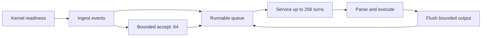

# Network frontends and client handoff

Rillcache has one command engine but several transport arrangements. The bind-time
choice decides who accepts sockets, which thread executes commands and whether a
data connection can stay on the thread that accepted it. That decision is visible
in `SchedulingPolicy` and in the `INFO`/benchmark fields that capture it.

## Default plain-TCP frontend

On Unix, an unconfigured server uses the Mio readiness reactor. `IoMode` defaults
to `Mio`; Tokio must be requested explicitly with `--io-mode tokio`. The reactor
uses epoll on Linux and kqueue where supported, and it keeps edge-triggered events
in a runnable queue until a read or write actually returns `WouldBlock`.

The reactor owns an indexed slot table rather than growing storage with total
connection count. A slot can be reused, but its selector token cannot: queued
events carrying an old token are ignored after reuse. Accept work is capped at 64
connections per pass, and accept readiness is retained if the kernel queue was not
drained, because edge-triggered readiness does not promise a second edge.

Each client gets bounded input and output vectors. A pass may execute at most 64
commands or produce roughly 64 KiB of output, after which it yields so a pipelined
client cannot monopolise the loop. One atomic reply may cross the soft output
limit; the limit is not a maximum RESP reply size or a process-wide memory bound.
Already-buffered input and output are serviced before an inactivity check, so
scheduler delay does not discard work.

## Socket workers and owner migration

When no persistence, ACL file, audit sink or TLS listener is configured, the
default number of plain-TCP reactors is `min(4, allowed CPUs)`, or the explicit
`--socket-workers` value from 1 to 16. The first reactor installs the owner-local
`ShardExecutor`; additional reactors accept connections but execute only bare
`PING`, `ECHO` and `QUIT` while the session is free of transaction, subscription,
monitor, blocked and paused state. The first other command detaches the connection
and sends it to the owner reactor.

Migration is a transfer of socket, buffers, session and pubsub receiver, not a
copy of the keyspace. The owner reactor drains its migration inbox on every pass
and registers the moved client with a fresh token. Shutdown joins every worker and
reports the first join error; a worker failure also sets the shared stop flag.

The safety-critical consequence is that ordinary data commands always execute
where the single `Data` value lives. More socket workers add accept and local-command
capacity, not additional keyspace partitions. The opt-in multi-owner router is a
separate execution path described in [ownership and sharding](ownership-and-sharding.md).

## Busy-client leases

On the portable managed-client fallback, and in the small-CPU default path before
the readiness reactor is selected, Rillcache can temporarily lend a busy client's
socket and buffers to an existing client thread. The owner thread parks without
performing I/O while the lease is active. A coordinator polls all loans with the
same bounded `Client::poll` used elsewhere, then returns each client to its home
thread.

Leases are deliberately short and bounded:

- one-CPU mode uses a 50 µs idle window and permits a single-reply yield;
- small multicore mode uses a 100 µs window and adaptive polling;
- a lease epoch has a 100 ms maximum even while traffic continues;
- more than four CPUs, an unknown capacity hint, fixed worker mode and TLS do not
  enable handoff;
- two coordinators are allowed at four CPUs only when Linux reports SMT disabled;
  missing or malformed status falls back to one.

The SMT probe reads at most three bytes and accepts exactly `0\n`. It is a
machine-wide hint, not an affinity claim or a physical-core count. The public
`client_handoff_*` fields in benchmark metadata record the policy actually used,
rather than resampling the host later.

## Fixed worker lanes

`--threads N` selects the portable bounded lane implementation instead of the
readiness reactor. Each lane owns a channel of admitted clients and polls them
round-robin with nonblocking sockets. A shared admission counter bounds queued,
active and in-flight clients by `max_clients`.

After real progress a lane polls for up to 50 µs before returning to its idle
park. Multi-lane runs also have a 100 µs cooperative run budget between voluntary
yields. Empty passes never rearm either window. With one lane, the lane installs
the local owner; with several lanes, commands use the shared compatibility path.

## Optional Tokio transport

Tokio is available only on Unix, with no fixed worker count and no append-only,
ACL-file or audit configuration. Those configurations retain the proven frontend
because journal sync/rewrite and ACL file operations are synchronous disk work
that must not run on a network runtime.

The plain Tokio path starts one current-thread runtime that accepts and serves
clients and owns `Data` locally. Ordinary commands do not cross a bridge. A second
bounded cold-service thread handles ACL `GENPASS`, paused/blocked resumption and
maintenance work that may touch disk. The cold queue has one permit and one queued
job, so it cannot grow into an unbounded blocking pool.

Mixed plaintext and TLS with Tokio uses the external compatibility owner and up to
`min(64, available_parallelism)` network runtimes. Runtime zero keeps the launcher's
affinity; only remote workers attempt safe per-worker affinity and log whether the
attempt succeeded. Shutdown stops acceptance, closes registered controls, drops
queued registrations, joins client tasks and lanes, drains cold work and then joins
the cold thread. The `--io-mode tokio` choice is a transport opt-in, not a claim
that async is faster; the repository records pipeline-1 trade-offs in its
[performance evidence](../boundaries/compatibility-and-production-gaps.md).

## Native TLS

`--tls-bind` starts a second listener; plaintext remains on `--bind` and the two
addresses must differ. The TLS acceptor is rustls with TLS 1.3 only. It loads a PEM
certificate chain and private key, optionally requires client certificates from a
PEM CA, completes the handshake under the configured handshake timeout, then
switches the socket to the idle timeout before handing it to the same RESP loop.

TLS connections use dedicated per-client threads in the current implementation.
They never use the busy-client lease path, and a mixed TLS configuration forces
the store to use the shared external owner so a plaintext reactor can exit without
destroying TLS-owned state. The transport exposes no OpenSSL or sidecar process;
the dependency exception is documented in [security and audit](../operations/security-and-audit.md).

## Acceptance and backpressure

Across frontends, admission is bounded by `max_clients`. A rejected client receives
`-ERR max number of clients reached` where the transport can still write, and is
then shut down. Reads are capped by `max_frame_bytes`; a full input buffer produces
the protocol frame-limit error and closes the connection. Output is flushed before
more input is consumed, and a single connection cannot execute the next command
while its reply is backpressured.

Shutdown is joined rather than detached: the accept loop stops, control sockets
are shut down, lanes and client threads are joined, the cold service is drained and
the store's owner status is checked. This is the transport half of the lifecycle;
the command half continues in the [request lifecycle](request-lifecycle.md).
