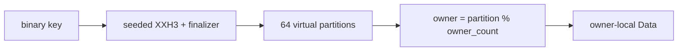

# Ownership, mailboxes and sharding

Rillcache separates *I/O ownership* from *data ownership*. Socket reactors and
client threads decide when work arrives; a `ShardExecutor` decides where mutable
data lives. The default process has one executor and no data-channel hop. The
opt-in multi-owner mode adds more executors, but it does not turn the server into
a cluster.

## One owner by default

`ShardExecutor` contains `RefCell<Data>` and is deliberately neither `Send` nor
`Sync`. `Data` holds entries, expiry indexes, mutation versions, eviction state and
payload accounting. It is constructed, borrowed and dropped on its owner thread.
No public guard or `Data` reference crosses a thread boundary.

The default Unix plaintext path installs this executor directly on the reactor or
single fixed worker. Ordinary commands, complete `EXEC` batches, expiry, effects
and journal capture therefore execute in one synchronous turn with no mailbox and
no shared data lock. Shared control-plane state — authentication, counters,
clients, observers and pub/sub — still uses its existing locks and is not claimed
to be lock-free.

The synchronous public `Store` API remains a compatibility bridge. Complete owned
operations and owned replies cross a bounded one-message mailbox; `Data` never
does. Admission happens before argument copying, so concurrent callers cannot
accumulate an unbounded queue of retained copies. This path is used by external
embedders, cold configurations, mixed TLS and portable multi-worker modes.

## Virtual partitions

`ShardRouter` maps a borrowed binary key to a shard using seeded XXH3 plus a
SplitMix64 finalizer. A layout is fixed for the process lifetime and supports one
to 64 shards; multi-shard layouts must be powers of two because routing uses a
mask. The seed is process-random, so placement is not stable across restarts and
is not a cryptographic HashDoS defence.

Multi-owner execution uses 64 virtual partitions whenever there is more than one
owner. `PartitionLayout` assigns partition `p` to owner `p % owner_count`, which
means any owner count from 1 to 64 is accepted and partitions are balanced within
one. The owner count is not required to be a power of two; only the virtual
partition count is.

There is no live resharding, migration or rebalancing. Starting a different owner
count creates a different placement for the next process, and replay seeds each
entry into its new owner before any frontend accepts clients.

## Multi-owner mailboxes

`--storage-owners N` with `N` from 2 to 64 starts one thread per owner. Each thread
builds a current-thread Tokio runtime and a `LocalSet`, constructs its
`OwnerCore` there and runs an `OwnerActor`. The actor awaits inbox readiness only
between turns; a command turn itself never awaits.

Each owner has two independent lanes:

- **DATA** carries ordinary owned command work and is disabled while the owner is
  fenced by a cross-owner reservation.
- **CONTROL** carries reserve, decide, scoped read/apply, release, abort and stop
  operations and remains available while DATA is fenced.

Message slots, retained input bytes and reply bytes are admitted by bounded
budgets. Admission is atomic across bytes and slots, so a waiter cannot hold one
resource while waiting for the other. A lane returns `Full` instead of blocking
the readiness reactor; the caller keeps the original commands and retries later.
CONTROL has burst priority, but after eight consecutive CONTROL deliveries an
unfenced owner must service ready DATA. The bound is a mailbox-turn guarantee, not
a latency SLO, and it prevents control traffic from starving data indefinitely.

## Single-owner and cross-owner commands

The router classifies a command before sending it:

- **Shared** control work goes to owner 0.
- **Owners** lists exactly the owners whose keys the command names.
- **Global** whole-keyspace commands such as `KEYS`, `SCAN`, `DBSIZE`, `FLUSHALL`
  and `INFO` involve every owner.

A command whose keys belong to one owner is one request/reply hop. A command that
spans owners takes whole-owner reservations in increasing owner order. While
fenced, the router validates once and executes against a scratch executor that
owns clones of only the keys the command may touch. It transplants back only keys
the command actually wrote, so a same-value write still advances `WATCH` versions
and a rejected command publishes no mutation.

The reservation protocol has three recorded stages: granted, decided and applied.
A lost grant acknowledgement aborts the fence; a failure after a decision is
fail-stop, not continued partial service. A cancelled reservation releases every
fence it acquired. Cross-owner `MSET`, `MGET`, `RENAME`, `COPY`, `MULTI`/`EXEC`
with `WATCH`, and blocking pops use this path. `EXEC` runtime errors still do not
roll back earlier commands, matching the single-owner contract.

Scratch cloning is capped at 32 MiB of retained key set for one command. That cap
is independent of the payload budget and prevents a hostile multi-key command
from pinning an unbounded second copy while owners are fenced.

## Deferred batches

The multi-owner socket adapter does not block on one round trip per remote
command. A parsed pipeline becomes one `BatchRun` whose slots retain the original
request order. Same-owner commands are grouped into a batch, and each batch is
submitted through a nonblocking admission. Replies may arrive in owner order, but
they are emitted only when every earlier slot is ready, preserving request order.

Deferred replies use their own bounded budget, separate from synchronous control
and data replies. A full deferred budget keeps the commands and retries on a later
pass; it never partially applies the batch. Cross-owner atomic commands, keyless
shared commands and blocking, pub/sub or session commands act as barriers and use
the synchronous reservation path. Slowlog entries retain the original argument
storage, so batching does not disable slow-command accounting.

The measured result is why multi-owner remains opt-in: deferred batches remove
most of the former round-trip penalty, but on the recorded host they still do not
beat the zero-hop one-owner path at pipeline 16. The mode is a correctness and
scaling seam, not a universal throughput claim.

## Blocking waits

A blocked connection is not parsed for further commands until its pop succeeds or
its timeout expires. The owner thread or lane checks the relevant keys roughly
every 10 ms. Waiting never holds a data borrow and never occupies an owner turn
between checks. In multi-owner mode, a blocking pop that can touch several owners
uses a scratch executor under reservations, so it observes one coherent key set
rather than racing independent owners.

The polling interval is a bounded latency/CPU trade-off, not a condition-variable
or server-push guarantee. The full reply and unblocking contract is covered in
[transactions, blocking and pub/sub](../features/transactions-blocking-and-pubsub.md).

## Accounting and observability

Payload accounting remains process-wide. Each owner publishes its contribution
to the shared credit total, and admission enforces the configured
`max_data_bytes` across owners rather than per owner. `INFO`, `MEMORY`, `STATS`
and `DBSIZE` gather one coherent aggregate for the duration of the command, then
clear the override so a stale total is never observed.

## Shutdown and failure

A router failure sets the shared fail-stop flag, requests server shutdown and
poisons further routing. Shutdown closes DATA admission, finishes admitted work,
sends a CONTROL stop to every owner, joins each owner thread and then closes the
request and reply budgets. The server reports a storage-owner failure rather than
continuing with partial data.

`--storage-owners` and `--io-mode tokio` are independent opt-ins. Neither changes
the default protected benchmark path, and neither provides replication, failover,
cluster routing or cross-process durability. The remaining production boundaries
are listed in [compatibility and production gaps](../boundaries/compatibility-and-production-gaps.md).
