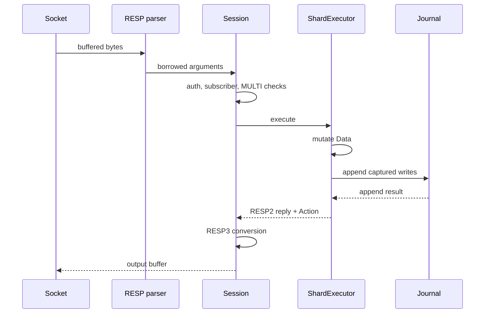

# Request lifecycle

A command crosses four boundaries: framing, session policy, data execution and
effect commit. Each boundary has a bounded responsibility. Keeping them separate
is what lets the reactor, the synchronous engine and the multi-owner router share
the same command semantics.

## 1. Receive and frame

The frontend reads at most 16 KiB per bounded pass into the connection's input
buffer. Reads stop at `max_frame_bytes`; a full buffer produces a protocol error
and closes the connection rather than growing without limit. Output is flushed
before another command is parsed, so a slow reader creates backpressure instead of
unbounded queueing.

`dispatch_request` accepts either a RESP array of bulk strings or a Redis inline
command. RESP arguments borrow slices of the input buffer. Inline arguments own
decoded bytes only for the duration of the callback. Every advertised length is
checked before allocation, and a partial frame returns `Ok(None)` without invoking
the executor.

The parser distinguishes a complete command from a fragmented one. A frame that
ends in the middle of a bulk payload is incomplete, not an empty value. An empty
request array, a null bulk argument, an oversized frame, an oversized argument and
too many arguments are separate protocol errors. The callback runs exactly once
for a valid frame and never for an incomplete or malformed one.

The canonical `PING` frame has a direct 14-byte path that bypasses generic array
parsing. Fragmented or non-canonical `PING` frames use the full parser, so the
shortcut changes cost, not accepted syntax. Defaults are 2 MiB per frame, 1 MiB per
bulk argument and 1024 arguments; both limits are configurable at startup.

## 2. Session policy

`Session` owns state that must not leak between connections: protocol version,
client identity, authentication, `MULTI`/`WATCH`, subscriptions, monitor state,
blocking wait state, pause state and the optional deferred-command slot.

`execute_on` first records the command against the client and evaluates the
hot-path gates. A bare `PING` in a plain, unauthenticated, unblocked session takes
the direct `+PONG` path. Every other command goes through `execute_inner`, which
applies, in order:

1. command counting and optional `MONITOR` delivery;
2. `RESET` and authentication exemption handling;
3. default-user or ACL authorization, including key and channel checks;
4. RESP2 subscriber restrictions;
5. `MULTI` queueing and transaction markers;
6. connection-local commands such as `HELLO`, `CLIENT`, `AUTH`, `ACL`, `SELECT`,
   pub/sub, blocking commands and `SHUTDOWN`;
7. the data-command path.

An authorization denial is written as the command's reply and recorded in the
optional audit sink. A denied command inside `MULTI` marks the transaction dirty,
so `EXEC` reports the standard abort rather than executing a partial queue. The
same ordering is used by the direct owner and the compatibility bridge.

## 3. Data execution

For an ordinary data command, `Session` calls `store.execute`. `Execution` is a
small trait implemented by both `ShardExecutor` and `MultiOwner`, so session
authorization, observer accounting and reply conversion do not depend on which
storage topology is active.

`ShardExecutor::execute` refreshes cached configuration when its epoch changes.
If journal or notification effects are enabled, it records the current journal and
flush sequence, executes the command, then commits effects. The command still
runs inside one synchronous owner turn: no borrow of `Data` survives socket I/O
and no other owner turn can interleave with it.

`execute_command` keeps `PING` ahead of family routing and calls the inlined
`GET`/`SET`/`ECHO` entry before the generic router. Everything else is routed by
family: strings, keyspace, collections, streams, pub/sub and administration.
Adding a command means adding its arm to the owning family module, not growing a
central match. `EXEC` replays queued store commands through the same family path.

In multi-owner mode the session may instead call the deferred boundary. Only
commands that can preserve reply order and session state are eligible. Connection
commands, blocking operations, pub/sub, transactions, latency collection,
commandstats and MONITOR keep the synchronous path. A deferred command returns no
reply immediately; the socket loop later appends the owner's reply in its original
pipeline slot.

## 4. Effects and journal commit

A mutation is only one part of a command. The engine may also need to produce
keyspace notifications, expiry/eviction lifecycle events, a journal record or an
error-stat entry.

`journal_marks` returns a sequence pair only when journaling or notifications are
active. After execution, `commit_journal` asks `Data` for the keys changed since
that sequence. It encodes a canonical write for each changed key, or a full
`FLUSHALL` image when a flush advanced the sequence. The record is appended while
the owner remains in its synchronous turn.

If the append fails, the already-written reply is truncated and replaced with an
`-ERR append-only write failed` response. A journal error is therefore visible to
the client instead of being reported as a successful mutation. Notification
events are published only after the journal append succeeds for that turn. With
both journaling and notifications disabled, `effects_enabled` is false and the
engine skips effect capture entirely.

The journal is not a second execution path for live commands: it stores write
records, while replay on startup reconstructs state through the ordinary command
implementation. The durability contract is covered in
[persistence and recovery](../storage/persistence-and-recovery.md).

## 5. Reply conversion and accounting

The engine writes RESP2 bytes. `Session::execute_store` then converts the newly
written slice to RESP3 if the connection negotiated RESP3. Conversion parses frame
boundaries recursively rather than searching for bytes inside payloads; malformed
internal output is left untouched. The conversion supports the scalar and array
types the current command set emits, not every RESP3 aggregate or push type.

The session epilogue records slowlog, latency and commandstats after conversion.
A reply beginning with `-` is also recorded in error statistics. `Action::Close`
tells the socket loop to stop after flushing the reply, which is how `QUIT`,
authentication failure limits and protocol errors end a connection.

## 6. Writeback and pipelining

The output buffer is flushed in bounded chunks. A pass may execute at most 64
commands or fill the output quantum, then yields to other clients. Already-buffered
input is consumed before reading again; a partial write leaves the remaining bytes
in place and suppresses the next command until backpressure clears.

Pipelined replies therefore stay in request order. In the single-owner path this
is automatic because commands execute inline. In multi-owner mode, reply slots
retain the original pipeline positions and a later reply cannot overtake an
earlier missing one. If a deferred admission is full, the command is retained and
retried without consuming more input, so the pipeline neither duplicates nor skips
a command.

The transport side of this handshake is described in
[network frontends and client handoff](network-frontends.md). Session negotiation
and discovery details continue in
[client protocol, sessions and discovery](../protocol/client-sessions-and-discovery.md).
