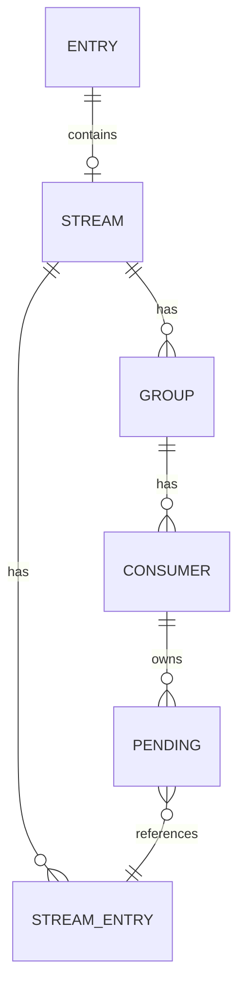

# Data types and command families

Every Rillcache key lives in one keyspace. A key's `Entry` can hold a raw string,
one collection, or one stream; it also carries the key's expiry, field TTLs and
payload length. There is no shadow namespace for hashes, streams or geo indexes.
This is why `TYPE`, `DEL`, `EXISTS`, `RENAME`, `COPY`, `SCAN` and expiry apply
uniformly across types.

## Strings and string-shaped types

A plain string is the entry's `Vec<u8>` value. Empty strings and absent keys are
distinct. String comparisons, indexes and ranges are binary-safe except where a
command explicitly parses UTF-8 numeric input, such as `INCRBYFLOAT`.

Two features use a string payload without being a separate Redis type:

- **Bitmaps** are ordinary strings addressed by MSB-first bit offsets. `SETBIT`
  zero-fills gaps, and `BITCOUNT`/`BITPOS` accept byte or bit ranges. The 512 MiB
  string semantic limit and 32-bit bit-offset range are checked before allocation.
- **HyperLogLog** is a private, versioned `HYLL` string. It starts as an exact
  sorted hash set, then promotes above 4,096 distinct hashes to a 2^14-register
  dense sketch. `TYPE` still reports `string`.

String commands reject collections and streams with `WRONGTYPE`. `MGET` returns
null for a non-string key, while `MSET` may replace any existing type. Multi-key
operations validate all inputs and the complete resulting payload before
publishing, so a wrong type or an over-budget write leaves the old state intact.

## Collections

`Collection` has packed and general representations for lists, sets, hashes and
sorted sets:

| Type | Representations |
| --- | --- |
| List | `ListPack` deque or chunked `ListQuick` deque |
| Set | ordered `Set`, packed `SetPack` or integer `SetInt` |
| Hash | map-backed `Hash` or ordered `HashPack` |
| Sorted set | map-backed `ZSet` or ordered `ZSetPack` |

The configured `list-max-listpack-size`, `set-max-intset-entries`,
`set-max-listpack-entries`, `hash-max-listpack-entries` and
`zset-max-listpack-entries` (plus value-size thresholds) select a representation
on the next write. Changing `CONFIG` does not rewrite an existing value until it
is mutated. These are real storage choices, not labels on one fixed layout.

Lists preserve order and support pushes, pops, range/index operations, insertion,
removal, trimming, position lookup, multi-pop, moves and blocking pops. Sets
provide membership, cardinality, algebra, store variants, bounded random
selection and `SMOVE`. Hashes add field-level TTLs, atomic `HSETEX`/`HGETEX`,
`HGETDEL` and random fields. Sorted sets add score and lex ranges, rank, algebra,
range stores, random members and pops.

Collection mutations stage a complete replacement value before payload admission.
A rejected write preserves the previous value and TTL. Empty collections are not
retained. A per-key bound of one million elements prevents unbounded growth from
zero-byte members. Payload accounting counts key bytes and member/field/value bytes,
not map capacity, numeric-score overhead or allocator slack.

Sorting and iteration order follow deliberate rules: set and hash read commands
sort by raw bytes for stable output, sorted sets sort by score then member, and
random commands use bounded local randomness. Redis does not promise a particular
random member, but Rillcache does not claim identical iteration order for every
aggregate.

## Streams

A `Stream` is a `BTreeMap<StreamId, StreamEntry>` plus the last generated ID,
entries-added and max-deleted counters, and consumer groups. A group contains its
last-delivered cursor, consumers and a pending-entry list.

The supported subset includes `XADD` with `NOMKSTREAM`, `MAXLEN`/`MINID`
retention and generated IDs; range reads; consumer groups, claims and
acknowledgements; pending summaries and extended listings; trimming; `XSETID`;
and `XINFO`. Stream IDs are unsigned 64-bit millisecond/sequence pairs. `XDEL`
removes a message but deliberately leaves pending references, because deletion is
not acknowledgement.

Stream entries, last IDs, group cursors, consumer objects and pending-entry owners,
delivery counts and timestamps are restored by journal replay. A pending id whose
entry was deleted or trimmed is retained through placeholder `XADD`/`XCLAIM`/`XDEL`
records, so `XPENDING` still reports it. Consumer activity time is not preserved:
`inactive` reflects replay time. `XCLAIM` of a tombstone removes it from the PEL as
for any missing entry. `entries-read` is reported as null and `nacked-count` as
zero. Treat this subset as a bounded queue with those documented restart limits,
not as a fully durable work queue.

## Geospatial values

Geo keys are ordinary sorted sets whose score is the 52-bit interleaved WGS-84
geohash (26 longitude bits and 26 latitude bits). `TYPE`, expiry, `ZADD`/`ZREM`,
`COPY`, `RENAME` and payload accounting therefore apply without a second index.

`GEOADD` validates every coordinate before writing. `GEOPOS`, `GEODIST`,
`GEOHASH`, `GEOSEARCH`, `GEORADIUS*` and `GEOSEARCHSTORE` share the Redis
haversine formulas and coordinate range. Searches scan the source sorted set
linearly; there is no native neighbour index, so complexity is O(N) in the set
size. `GEOSEARCHSTORE` replaces its destination atomically and clears its TTL; an
empty result deletes it.

## HyperLogLog

`PFADD`, `PFCOUNT` and `PFMERGE` operate on the private HLL string. The exact
small-cardinality set is bounded by 4,096 hashes; the dense sketch has 16,384
one-byte registers. The estimator uses linear counting at low occupancy and the
standard HyperLogLog estimator above it, with roughly 0.81% standard error at
large cardinalities.

The payload is **not** Redis's sparse/dense encoding. `PFDEBUG`, `PFSELFTEST`,
sparse-threshold configuration and cross-vendor HLL payload interchange are not
implemented. Malformed payloads and ordinary strings without the HLL header are
rejected, and promotion/merge is staged before admission.

## Shared command plumbing

`ShardExecutor::execute_command` keeps `PING` at the top and calls the inlined
`GET`/`SET`/`ECHO` entry before the family router. Every other command is owned by
one of six family modules:

- `strings`: string ranges, bitmaps, HyperLogLog, LCS and floating-point strings;
- `keyspace`: key lifecycle, expiry, rename/copy, scans and database-wide commands;
- `collections`: lists, sets, hashes, sorted sets, geo and sort;
- `streams`: the `X*` subset;
- `pubsub`: publish and sharded publish;
- `admin`: configuration, server administration, discovery and unsupported replies.

A new command belongs in its family, not in a central match. Session-only
commands such as `MULTI`, `EXEC`, blocking waits, subscriptions and client
metadata stay in the session layer. `EXEC` replays queued store commands through
the same family router.

## Limits and failure behavior

- A failed mutation is atomic with respect to the old value, TTL and accounting.
- Integer and float operations reject overflow, invalid numbers and non-finite
  results without writing.
- Multi-key commands validate every source and the final payload before changing
  any key.
- Index and count parsing uses canonical signed integers; negative indexes count
  from the end where the command supports it.
- Replies and requests remain bounded by the configured frame, bulk and payload
  limits; collection limits are not an RSS cap.
- No module, Lua script, function or command extension can add a new type.

The compatibility boundary and the missing evidence are recorded in
[compatibility and production gaps](../boundaries/compatibility-and-production-gaps.md).
The key-level lifecycle is described in
[data model and expiry](../storage/data-model-and-expiry.md).
