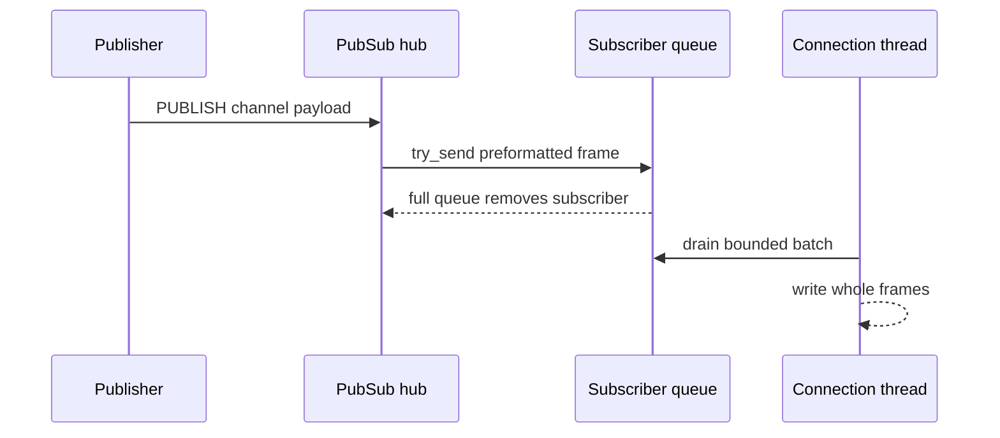

# Transactions, blocking and pub/sub

These features share a property: their state belongs to a connection, not to a
key. The engine executes data commands, but the session decides when a command is
queued, when a client waits, and which messages a connection is allowed to
receive.

## MULTI, EXEC and DISCARD

`MULTI` creates connection-local queue state and replies `+OK`. Nesting is an
error. While queueing, a supported command with valid command-table arity is stored
by value and replies `+QUEUED`. The queue is bounded at 10,000 commands.

Queue-time errors are sticky. An unknown command, an arity mismatch, a
connection-local command such as `HELLO`, `CLIENT`, `SELECT`, `AUTH`,
subscription commands or `PUBSUB`, and `SHUTDOWN` all mark the transaction dirty.
`EXEC` then returns:

```text
-EXECABORT Transaction discarded because of previous errors.
```

and executes nothing. `QUIT` executes immediately and discards the queue. `WATCH`
inside `MULTI` is rejected but does not by itself dirty the transaction.

Before executing, `EXEC` re-checks authorization for every queued command. This
closes the window where an ACL change between queueing and execution could
otherwise commit a revoked command. The complete batch then runs in one
synchronous owner turn. Each command's reply is appended as one RESP array; a
command-level error is an element and later commands still run. There is no
rollback of earlier successful commands.

In multi-owner mode, the router validates all participating owners under one
reservation and replays the batch on a fenced executor. `EXEC` is one request, not
independently routed constituent commands. No other data operation can interleave
between two commands of the same batch.

## WATCH and optimistic conflicts

`WATCH key [key ...]` records each key's mutation version, logical presence and
the store epoch. Repeated `WATCH` calls merge or replace observations per key.
`UNWATCH`, `DISCARD`, `EXEC`, `QUIT` and disconnect clear them.

At `EXEC`, every token is rechecked against the current owner. A mismatch in the
key's version, presence, expiry visibility or store epoch aborts the transaction
with a null array and changes no data. Expiry is evaluated with the store clock;
no polling is involved. A flush advances the epoch.

The version table is bounded at 65,536 entries. If it must evict, or after a
flush, the epoch advances so outstanding watches fail closed. The failure mode is
an unnecessary abort, never a missed mutation. Version metadata is not part of
the persisted payload or the payload budget.

## Blocking commands

Blocking list, list-move, sorted-set, stream and `WAITAOF` commands first attempt
the operation immediately. If no value is ready, the session stores a `Blocked`
record containing the keys, a deadline and the command-specific continuation,
and writes no reply.

The connection is not parsed for further commands while blocked. Pipelined bytes
remain in the bounded input buffer and execute in order after unblocking. The
ordinary socket inactivity timeout does not apply to the wait, but the command
timeout does. A timeout of zero means wait indefinitely; negative, NaN, infinite
or out-of-range timeouts are errors.

The owner thread or lane polls the relevant keys about every 10 ms. That is a
bounded latency/CPU trade-off, not a condition-variable wakeup, push notification
or hard real-time deadline. A successful pop or move commits its journal records
and notifications before the reply is emitted. A disconnect or server shutdown
drops the blocked state and closes the connection.

Connection-local and blocking commands are rejected at `MULTI` queue time rather
than executed at `EXEC` time. This is a documented divergence from Redis for
commands such as `BLPOP`, `BRPOP`, `BLMOVE` and `BRPOPLPUSH`. `BLMPOP`, `BZMPOP`
and blocking `XREAD` variants that are accepted inside `MULTI` execute once
non-blockingly at `EXEC` after timeout validation.

## Pub/sub delivery

`SUBSCRIBE`, `PSUBSCRIBE`, `SSUBSCRIBE` and their unsubscribe counterparts manage
three namespaces: exact channels, patterns and sharded channels. Normal and
sharded channels are independent even when their bytes match.

Each admitted connection owns a bounded 1,024-frame message queue. A publisher
uses non-blocking sends. If a queue is full or disconnected, that subscriber is
removed and the frame is not delivered. A slow subscriber cannot block the
publisher or other subscribers.

Messages are preformatted whole frames and written only by the owning connection
thread, so a push cannot interleave with a reply. RESP2 uses arrays; RESP3 uses
push frames:

```text
*3 message  channel payload
*4 pmessage pattern channel payload
*3 smessage channel payload
```

In RESP2, a subscribed connection may only use subscribe/unsubscribe commands,
`PING`, `QUIT` and `RESET`. In RESP3, ordinary commands remain available. `RESET`
unsubscribes everything and returns the session to RESP2. Subscription changes
and `PUBSUB` introspection are not queued in `MULTI`; `PUBLISH` and `SPUBLISH`
are ordinary queued commands and deliver once at `EXEC`.

Delivery is in-process and at-most-once. There is no persistence, replication,
acknowledgement, replay, dead-letter queue or ordering guarantee across different
publishers. Sharded channels do not imply cluster hash-slot routing.



## Keyspace notifications

When `--notify-keyspace-events` or `CONFIG SET notify-keyspace-events` enables
categories, a mutation publishes Redis-shaped messages to:

```text
__keyspace@0__:<key>     payload: <event>
__keyevent@0__:<event>   payload: <key>
```

`K` enables the keyspace channel, `E` the keyevent channel, and the category flags
`g$lshztxe` select generic, string, list, set, hash, sorted-set, stream, expired
and evicted events. `A` expands to `g$lshztxe`; unlike Redis it excludes key-miss,
new-key and module classes. Unknown flags and unsupported classes are rejected at
configuration time.

Events are emitted only for keys the command actually changed. A rejected
`SET NX`, overflow, wrong type or payload rejection emits no mutation event.
`MULTI` emits each command's events in execution order. Blocking pops emit
`lpop`/`rpop` or `zpopmin`/`zpopmax`.

Expiry and eviction use separate bounded lifecycle queues of 1,024 keys each.
They are drained after the triggering command or maintenance pass and published
before that command's own mutation events. Under sustained pressure older
lifecycle records can be dropped. `FLUSHDB`/`FLUSHALL` deliberately emit no
keyless event, and no event is queued for an offline subscriber.

Notification delivery is at-most-once, process-local and not persisted or
replicated. It is not a complete audit log, a cache-coherence guarantee or a
durable work queue.

## Ownership interaction

Blocking waits never hold a data borrow. In multi-owner mode, a blocking command
that spans owners uses a fenced scratch executor for a coherent key set. Pub/sub
and notification fan-out live in `ServerServices`, not in any owner's `Data`.
The owner only supplies mutation events and journal ordering.

The transport must keep servicing other clients while one client blocks or waits
for a push. That scheduling contract is in
[network frontends and client handoff](../architecture/network-frontends.md).
The remaining delivery and durability limits are in
[compatibility and production gaps](../boundaries/compatibility-and-production-gaps.md).
