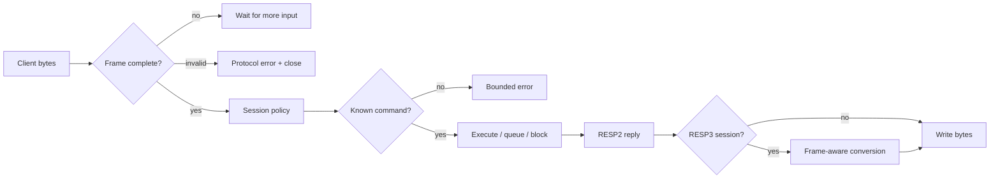

# Client protocol, sessions and discovery

Rillcache accepts Redis RESP arrays and inline commands over a byte stream. A
connection starts in RESP2, negotiates RESP3 with `HELLO`, and keeps its protocol,
identity and session state as the socket moves between workers.

## Framing and limits

`dispatch_request` accepts:

- a RESP non-empty array of non-null bulk strings;
- a Redis inline line with whitespace, quotes, escapes and `\xHH` bytes.

RESP arguments borrow input slices, and the executor runs only after a complete,
valid frame. Inline arguments own decoded bytes only for the callback. Partial
frames return `Ok(None)` without executing anything.

Defaults:

| Limit | Default | Maximum |
| --- | --- | --- |
| Complete request frame | 2 MiB | 512 MiB |
| Single bulk argument | 1 MiB | 512 MiB |
| Arguments per request | 1024 | fixed default |
| Socket idle timeout | 30 s | positive duration |

The bulk limit must fit inside the frame limit. Lengths are checked before
allocation, and arithmetic overflow is a protocol error. A frame-sized response is
not implied: individual commands may impose stricter reply bounds, such as the
2 MiB `MGET`/`HGETEX` reply caps.

Deliberate strictness:

- an empty request array is rejected rather than ignored;
- a null bulk argument is rejected in a request;
- a request frame over the limit closes the connection after a protocol error;
- malformed inline quoting, an invalid terminator or a truncated final frame is
  an error;
- unknown commands and unsupported options return bounded errors without
  reflecting arbitrary input bytes.

The canonical `PING` frame has a direct parser path; fragmented and non-canonical
frames still use the full parser.

## HELLO and RESP3

`HELLO` with no argument reports the current protocol. `HELLO 2` and `HELLO 3`
select a protocol. Any other version returns `NOPROTO unsupported protocol
version`.

The reply identifies the server truthfully:

```text
server   rillcache
version  <crate version>
proto    2 or 3
id       <connection id>
mode     standalone
```

`server`, `version` and `mode` are bulk strings; `proto` and `id` are RESP
integers. RESP2 returns a ten-element array; RESP3 returns a five-pair map. The
reply does not claim a Redis version, modules, replication role or unsupported
capability.

`HELLO 3 AUTH <user> <password> SETNAME <name>` parses and validates every option
before changing protocol, metadata or authentication state. A rejected option or
credential leaves all three unchanged. A failed `HELLO` therefore cannot
partially switch a session.

RESP3 conversion is per reply and frame-aware. It converts RESP2 null bulk
(`$-1`) and null array (`*-1`) frames to the RESP3 null `_`, and preserves binary
payload bytes even when they resemble a RESP frame. Push frames are used for
pub/sub delivery. The current data commands do not emit RESP3 booleans, maps, sets,
attributes or streaming aggregates.

This is not full RESP3 or Redis tracking. `CLIENT TRACKING`, redirection,
invalidation, `NO-EVICT`/`NO-TOUCH`, multiple logical databases and arbitrary
RESP3 push types are absent.

## Per-connection state

`Session` owns:

- protocol version and monotonically assigned client ID;
- optional client name, library name and library version;
- authenticated user;
- failed-auth count and close-request state;
- `MULTI` queue, `WATCH` state and deferred-command slot;
- channel, pattern and sharded-channel subscriptions;
- monitor, blocked and paused state;
- pub/sub sender and per-connection client metadata.

Names are limited to 256 bytes and library fields to 128 bytes. Values must be
printable non-space ASCII (`!` through `~`). An empty `CLIENT SETNAME` clears the
name.

State moves with the connection across worker handoff and socket leases. It is
not reconstructed from another connection and is not shared across sessions.

## CLIENT commands

Supported connection commands are:

- `CLIENT ID`
- `CLIENT SETNAME` / `GETNAME`
- `CLIENT SETINFO LIB-NAME|LIB-VER`
- `CLIENT INFO`
- `CLIENT LIST [TYPE ...] [ID ...]`
- `CLIENT KILL` with legacy address or filtered `ID`, `ADDR`, `LADDR`, `TYPE`,
  `USER`, `MAXAGE` and `SKIPME`
- `CLIENT PAUSE` / `UNPAUSE`
- `CLIENT UNBLOCK`
- `SELECT 0`
- `RESET`

`CLIENT INFO` returns the retained ID, database zero, name, library metadata,
address, local address, RESP version and user. `CLIENT LIST` returns one
newline-delimited record per registered connection with ID, addresses, name, age,
flags, database, subscription counts, RESP version, user and library fields.

Fields the server does not measure — file descriptor, idle time, last command,
buffer sizes, memory, redirection and network totals — are omitted rather than
invented. `INFO clients` reports connected, max and blocked counts.

`CLIENT PAUSE timeout [WRITE|ALL]` defers new commands for a non-negative
millisecond interval. `WRITE` keeps reads moving while writes and `EXEC` wait.
A later deadline wins, and an active `ALL` pause is not downgraded to `WRITE`.
`CLIENT UNPAUSE` ends it. Management commands are exempt. A paused connection
executes at most one deferred command and stops parsing its pipeline until the
pause ends.

`CLIENT UNBLOCK <id> [TIMEOUT|ERROR]` wakes only a currently blocked connection
and returns 1, or 0 for unknown/non-blocked IDs. `TIMEOUT` returns a null;
`ERROR` returns the `UNBLOCKED` error. The request is consumed once and is local
to this process.

`CLIENT KILL` filters intersect. `SKIPME yes` is the default; `SKIPME no` may kill
the caller, in which case the reply can race the socket close. Master/replica
types match nothing because the server is standalone.

## SELECT and RESET

Only database 0 exists. `SELECT 0` returns `+OK`; a nonzero index returns
`ERR DB index is out of range`; malformed input returns `ERR invalid DB index`.
The session never aliases another database to zero.

`RESET` is disconnect-equivalent state reset:

- discards `MULTI` and `WATCH`;
- clears blocked/paused state;
- unsubscribes channel, pattern and sharded-channel state;
- leaves monitor mode;
- returns to RESP2 and database zero;
- clears the authenticated user, so a protected deployment requires `AUTH`
  again;
- retains the client name and library metadata;
- replies `+RESET`.

`RESET` is allowed without authentication and from RESP2 subscriber mode.

## COMMAND discovery

The registry contains 243 commands grouped by feature family. It is flattened and
name-sorted once; every lookup and enumeration reads that one registry.

Supported discovery:

- `COMMAND` returns six-field legacy metadata: name, arity, flags, first key,
  last key and key step.
- `COMMAND COUNT`.
- `COMMAND INFO [name ...]`; unknown names produce null metadata.
- `COMMAND LIST`.
- `COMMAND LIST FILTERBY PATTERN|ACLCAT|MODULE`; module filtering is empty
  because no modules exist.
- `COMMAND GETKEYS` using the same declared key extraction as ACL enforcement.
- `COMMAND GETKEYSANDFLAGS` with one `RO` or `RW` primary access flag per key.

Key extraction handles counted key lists, `STORE` destinations, `BITOP`,
`SINTERCARD`, `Z*` algebra, `XREAD`/`XREADGROUP` `STREAMS` blocks and legacy geo
store forms. Dynamic `SORT BY`/`GET` keys require all-key access because they are
not statically declared.

The metadata is the legacy six-field shape, not Redis's extended command schema.
It describes this implementation's declared command interface; it does not
advertise missing Redis commands. Granular sub-flags such as `OW`, `RM`, `access`,
`update`, `insert` and `delete` are not provided.



## Compatibility boundary

The server speaks RESP2 and a bounded RESP3 subset. It does not implement full
RESP3 tracking/push semantics, multiple databases, arbitrary client metadata or
the complete Redis `COMMAND` schema. Real Python/Node/Go client-library
interoperability is not in the required CI matrix; a pinned `redis-cli` test is
not a substitute.

The command surface and remaining gaps are listed in
[compatibility and production gaps](../boundaries/compatibility-and-production-gaps.md).
Request execution is described in the
[request lifecycle](../architecture/request-lifecycle.md).
